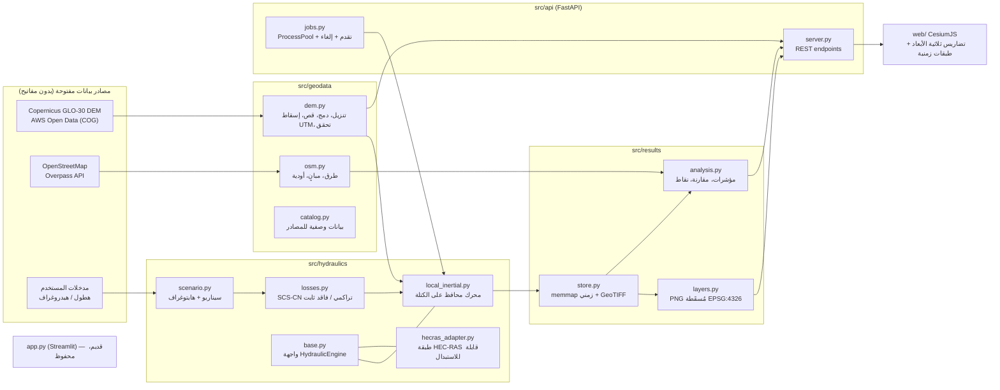

# المخطط المعماري

## 1. المكونات وتدفق البيانات

## 2. مبادئ الفصل

| الطبقة | المسؤولية | لا تعرف عن |
|---|---|---|
| `geodata` | الحصول على البيانات الحقيقية والتحقق منها وإسقاطها إلى شبكة مترية | المحرك والواجهة |
| `hydraulics` | الفيزياء فقط: مصفوفات + Scenario ← لقطات زمنية + ميزان كتلة | الملفات وHTTP والألوان |
| `results` | تخزين اللقطات وإنتاج طبقات العرض والمؤشرات | طريقة الحساب |
| `api` | الوظائف الخلفية والتقدم والإلغاء وتقديم الطبقات | تفاصيل الفيزياء |
| `web` | العرض فقط: يقرأ نتائج محسوبة ولا يولّد أي حركة مياه | — |

**العرض منفصل عن الحساب**: يتنقل شريط الزمن بين صور PNG محسوبة مسبقًا لكل لقطة. لا يحدث أي حساب ولا أي تحريك اصطناعي للماء في المتصفح.

## 3. المحرك الهيدروليكي: Local Inertial (Bates et al., 2010)

المعادلات على شبكة منتظمة (Δx متري، EPSG UTM):

- **الاستمرارية**: `h(t+Δt) = h + Δt/Δx · (Σq_in − Σq_out) + R_eff·Δt − I_ponded·Δt`
- **كمية الحركة (لكل وجه خلية)**:
  `q(t+Δt) = [q − g·h_flow·Δt·∂η/∂x] / [1 + g·Δt·n²·|q| / h_flow^(7/3)]`
  حيث `η = z + h` و`h_flow = max(η_i, η_j) − max(z_i, z_j)`
- **الخطوة الزمنية (CFL)**: `Δt = α·Δx / √(g·h_max)`، حيث `α = 0.7`، مع حد أعلى `dt_max`.
- **الإيجابية**: محدِّد حجمي لكل خلية، بحيث لا تتجاوز الكمية الخارجة الحجم المتاح فيها. يُطبَّق المعامل على الوجه نفسه من الجهتين، فتبقى الكتلة محفوظة حتى دقة الآلة.
- **الحدود**: `closed` (جدار) أو `open` (تصريف حر بعمق طبيعي `q = h^(5/3)·√S₀/n` نحو الخارج فقط)، مع قناع `sink` اختياري (مثل البحر).
- **ميزان الكتلة**: `ΔStorage − (V_rain_excess + V_inflow − V_boundary_out − V_infiltration)` يُحسب ويُحفظ لكل تشغيل.

المراجع: Bates, Horritt & Fewtrell (2010) J. Hydrology 387:33–45؛ de Almeida et al. (2012) WRR 48. نموذج الفواقد SCS-CN: USDA NRCS NEH Part 630 Ch.10.

## 4. طبقة HEC-RAS
`HecRasAdapter` يطبّق واجهة `HydraulicEngine`، ويقوم بما يلي:
- يكتشف وجود `Ras.exe` (في المسارات القياسية أو في الإعدادات).
- يشغّل خطة مشروع جاهز عبر COM (`RASCOM.HECRASController`، ويتطلب `pywin32`).
- يقرأ نتائج HDF5 من المسار `Results/Unsteady/Output/Output Blocks/Base Output/Unsteady Time Series/2D Flow Areas/<Area>/Depth` (ويتطلب `h5py`).

> [!WARNING]
> هذه الطبقة **غير مختبرة**، لأن HEC-RAS غير مثبت على جهاز التطوير. كما أن بناء هندسة المنطقة ثنائية الأبعاد في HEC-RAS (mesh، شروط الحدود) يتم يدويًا في RAS Mapper ولا تتم أتمتته هنا.

## 5. التخزين والأداء
- **DEM**: يُقرأ من COG عن بُعد عبر GDAL `/vsicurl/` (القراءة لنافذة المنطقة فقط)، ويُخزَّن مؤقتًا في `data/cache/dem/`.
- **النتائج**: `data/runs/<run_id>/`، وتتضمن مكدسات `depth/u/v` بتنسيق `.npy` (memmap)، وملفات `max_depth.tif` و`max_speed.tif` و`arrival_time.tif` بتنسيق GeoTIFF، ومجلد `layers/` يحتوي PNG لكل لقطة، إضافة إلى `summary.json`.
- **المتصفح** يحمّل صورة PNG واحدة صغيرة لكل لقطة، ولا يحمّل مصفوفات خام.
- **الحسابات الطويلة** تعمل في `ProcessPoolExecutor`، وتُتابَع عبر ملف `progress.json`، ويتم الإلغاء عبر ملف `cancel`. لذلك لا تتجمد الواجهة.
- **حد حجم الشبكة**: هناك حد أقصى قابل للضبط لعدد الخلايا، ويمكن تخشين الدقة (30/60/90 م). أما تقسيم المناطق الكبيرة إلى نطاقات مستقلة فهو مخطط لمرحلة لاحقة (انظر خطة التنفيذ).
